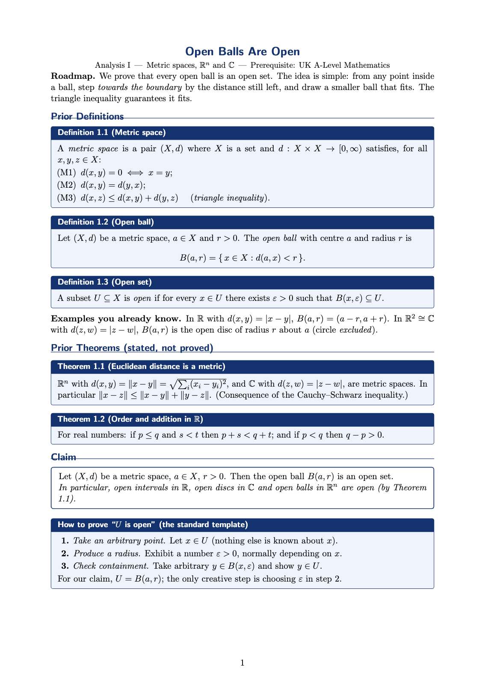
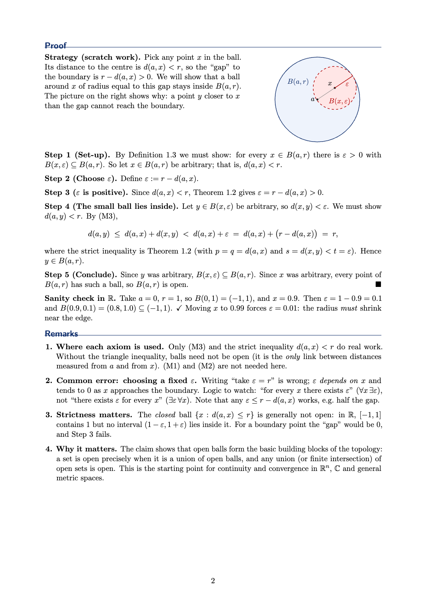
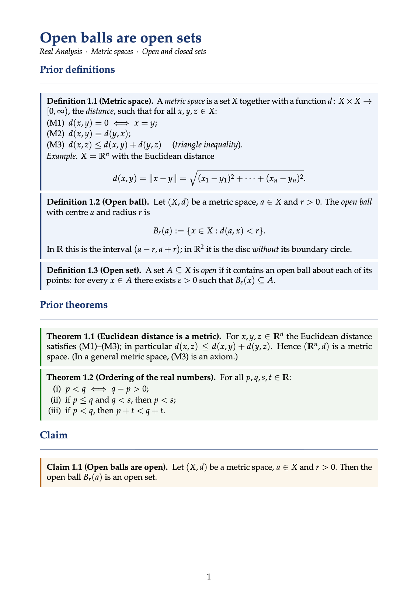
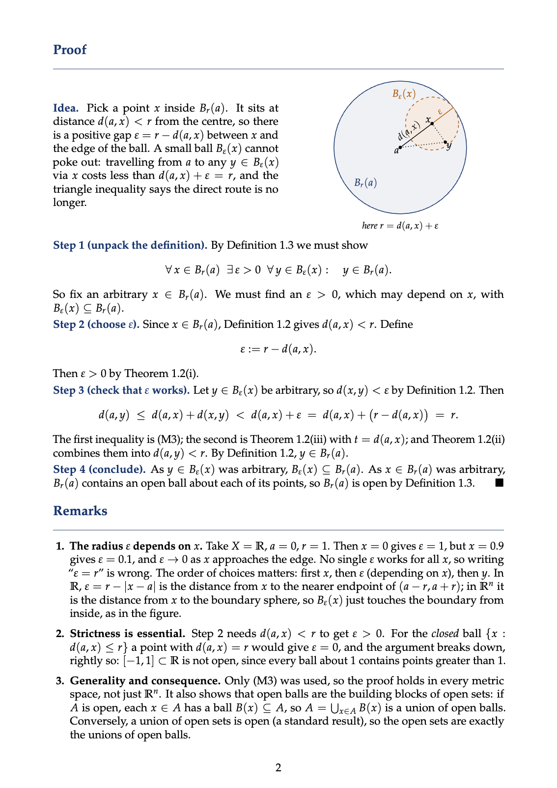

# Investigation into LLMs

## Context
- To ensure fairness we will: 
  - Be using Claude's Sonnet 5.5 for each test 
  - Be using a new chat each time to make things consistent

## Baseline (Basic Prompting)
### Prompt
> Can you prove that an open ball is open?

### Response
> Yes. Work in a metric space (X, d), and let B(x₀, r) = {x ∈ X : d(x, x₀) < r} with r > 0.
>
> **Claim:** B(x₀, r) is open, meaning that for every point y in the ball there is some ε > 0 with B(y, ε) ⊆ B(x₀, r).
>
> **Proof.** Let y ∈ B(x₀, r). Then d(y, x₀) < r, so
>
> ε := r − d(y, x₀) > 0.
>
> We show B(y, ε) ⊆ B(x₀, r). Take any z ∈ B(y, ε), so d(z, y) < ε. By the triangle inequality,
>
> d(z, x₀) ≤ d(z, y) + d(y, x₀) < ε + d(y, x₀) = r.
>
> Hence d(z, x₀) < r, i.e. z ∈ B(x₀, r). Since z was arbitrary, B(y, ε) ⊆ B(x₀, r).
>
> Since y was an arbitrary point of B(x₀, r), every point of the ball has a small ball around it that stays inside, so B(x₀, r) is open. ∎
>
> **Intuition:** y sits at distance d(y, x₀) from the centre, so there is a gap of r − d(y, x₀) between y and the boundary. A ball of that radius around y can't poke out, and the triangle inequality is what guarantees it.
>
> Two quick notes:
> - The strict inequality is essential. For the *closed* ball {x : d(x, x₀) ≤ r}, the same argument fails at points with d(y, x₀) = r, where ε would be 0. In ℝ, [a, b] is not open for exactly this reason.
> - In ℝⁿ with the Euclidean metric this is the familiar statement that open discs and open intervals are open sets.

## Technique 1 (Persona Prompting)
### Prompt
> You are a Harvard mathematics professor with over 10 years of experience teaching real & complex mathematics to first-year and second-year students. Can you prove to me that the open ball is indeed open?

### Response
> # The open ball is open
>
> ## Setup
>
> Let $(X,d)$ be a metric space. For $x \in X$ and $r > 0$, the open ball is
>
> $$B(x,r) = \{\, y \in X : d(x,y) < r \,\}.$$
>
> **Definition.** A set $U \subseteq X$ is *open* if for every $y \in U$ there exists $\varepsilon > 0$ such that $B(y,\varepsilon) \subseteq U$.
>
> This covers $\mathbb{R}$ with $d(x,y)=|x-y|$, $\mathbb{C}$ with $d(z,w)=|z-w|$, and $\mathbb{R}^n$ with the Euclidean metric as special cases.
>
> ## Claim
>
> For every $x\in X$ and $r>0$, the set $B(x,r)$ is open.
>
> ## Proof
>
> Let $y \in B(x,r)$ be arbitrary. We must find an $\varepsilon>0$ with $B(y,\varepsilon)\subseteq B(x,r)$.
>
> **Choosing $\varepsilon$.** Since $y\in B(x,r)$, we have $d(x,y)<r$. Define
>
> $$\varepsilon := r - d(x,y).$$
>
> Then $\varepsilon > 0$. This is the only place we use that $y$ lies in the ball.
>
> **Showing the inclusion.** Let $z \in B(y,\varepsilon)$, so $d(y,z) < \varepsilon$. By the triangle inequality,
>
> $$d(x,z) \le d(x,y) + d(y,z) < d(x,y) + \varepsilon = d(x,y) + \big(r - d(x,y)\big) = r.$$
>
> Hence $d(x,z)<r$, i.e. $z \in B(x,r)$. Since $z$ was arbitrary, $B(y,\varepsilon)\subseteq B(x,r)$.
>
> **Conclusion.** Since $y \in B(x,r)$ was arbitrary, every point of $B(x,r)$ has a ball around it contained in $B(x,r)$. Therefore $B(x,r)$ is open. $\blacksquare$
>
> ## Remarks
>
> 1. **The triangle inequality is the whole proof.** Without it, "balls" need not be open. It is what makes a ball centered at $y$ of radius $r-d(x,y)$ fit inside the original ball.
>
> 2. **Geometric picture.** If $y$ sits close to the edge of $B(x,r)$, then $\varepsilon = r-d(x,y)$ is small: you can only fit a tiny ball around $y$. The closer $y$ is to the boundary, the smaller $\varepsilon$ must be, but it is always strictly positive because the boundary itself is excluded. This is why the strict inequality $<$ matters.
>
> 3. **Sanity check in $\mathbb{R}$.** Here $B(x,r) = (x-r,\,x+r)$. For $y$ in this interval, $\varepsilon = \min(y-(x-r),\,(x+r)-y)$ would be the largest radius that works, and our choice $r-|x-y|$ equals exactly that. So in $\mathbb{R}$ the proof is sharp.
>
> 4. **Closed balls need not be open.** The closed ball $\{y: d(x,y)\le r\}$ fails this argument at points with $d(x,y)=r$, where $\varepsilon$ would be $0$. For example, $[a,b]\subset\mathbb{R}$ is not open, since no interval around $b$ stays inside $[a,b]$. (In some metric spaces, like a discrete one, a closed ball can happen to be open, but that's a feature of the space and not a general fact.)
>
> If you'd like, I can follow this up with the next natural results: arbitrary unions of open balls are open, finite intersections are open, and how these give you the topology induced by a metric.

### Analysis of the Prompt
#### What has changed
- It was a lot more well-structured as:
  - It provided **clear definitions** on what an open ball actually is
  - It provided a **clear layout** with the 
    - Reasonable definitions, for a mathematics student at this stage
    - The actual claim we wish to prove
    - The proof itself
- It provided _remarks_, which is what a lot of mathematics professors actually do in lecture notes, mimicking the persona requested well
- Gave a nice ending by suggesting next steps for a student's learning
- Utilised LaTeX (the markup language used to write mathematical papers) in their response to actually structure their proof better

#### Why did it change
- The big reason was because we ensured the AI acted like a mathematics professor, who would structure their arguments, use LaTeX when typing up a proof and use clear cut definitions

#### Comparison
- The response differed from the previous as it was generally a lot more verbose and in depth compared to the basic prompt given. 

#### Improvement or no
- The change was a significant improvement as
  - The use of LaTeX enabled the response to be lot mor visually appealing to a mathematics student
  - There was an actual defined structure one can follow, like a mathematics professor would do

## Technique 2 (Markdown+ XML Tags + Providing Clear Instructions)
### Prompt

> # Identity
>
> You are a Harvard mathematics professor with over 10 years of experience teaching real & complex mathematics to first-year and second-year students. Can you prove to me that the open ball is indeed open?
>
> # Instructions
>
> - In the structure, I have requested you to state the theorems needed that the proof relies on; do not prove them and just state what they are.
> - Store your answer in the form of a 2-page PDF that is easy for one to digest.
> - Ensure you use LaTeX to structure your answer well, as a mathematics professor.
> - To avoid proving everything from mathematical axioms, assume someone has a working knowledge of mathematics to a UK A-Level standard.
> - Perform some thorough research on what constitutes the best academic teaching practices and create a rubric based on your research. Continuously iterate your response until you meet the criteria of the rubric; do not give me your thought process, only the final output.
>
> # Structure
>
> \<prior definitions>
>
>   Definitions 1.1: ...
>
> \</prior definitions>
>
> \<prior theorems>
>
>   Theorem 1.1: ...
>
> \</prior theorems>
>
> \<claim>
>
> \</claim>
>
> \<proof>
>
> \</proof>
>
> \<remarks>
>
> \</remarks>

### Response
> 
> 

### Analysis of the Prompt
#### What has changed
-  The response was given in a PDF format mimicking what a professor would actually give to it's students
-  It (at least attempted to) go more in depth with the material
-  The definitions feel more rigorous than before.
-  The proof was given in step by step instruction
-  The structure is a lot clearer
-  There are images to show one's points withing the proof

#### Why did it change
- The instructions (seemingly felt) a lot more specific due to the use of Markdown and XML Tags
- It was given a lot more room to work with (2 PDF pages) allowing it to go more in depth with it's definitions

#### Comparison
- It feels a lot more in depth compared to the first two responses

#### Improvement or no
- I actually don't think it is a big improvement overall to the first technique
- The upsides to this prompt
  - A student who has little knowledge on the definitions of a metric space is given more clarity on what a metric space is
  - Images are given to allow people who don't think in pictures to understand the proof better
  
- Downsides to this prompt
  - There are some visual problems with the PDF (blue lines cutting through the headers)
  - There is a lot of fluff within the PDF, such as the prerequisites, the roadmap, "how to prove U is open" section despite their being scratch work straight afterwards, I think this is the big reason why it's not that big of a improvement.

## Technique 3 (Context)
### Note: These were attached contextual documents fed into prompt as PDFs (just put as attatched links here for ease)
[FUNCTIONAL ANALYSIS: Basic Definitions in Topology | WikiMath](https://wiki.math.ntnu.no/_media/tma4230/2010v/topol-def.pdf)

[Open Sets and Closed Sets | QMUL](https://webspace.maths.qmul.ac.uk/m.jerrum/MTH6126/note4.pdf)

[Open and Closed Sets | Robert J Carroll](https://robertjcarroll.com/notes/open-and-closed-sets.pdf)

### Prompt
> # Identity
>
> You are a Harvard mathematics professor with over 10 years of experience teaching real & complex mathematics to first-year and second-year students. Can you prove to me that the open ball is indeed open?
>
> # Instructions
> 
> * In the structure, I have requested you to state the theorems needed that the proof relies on; do not prove them and just state what they are.
> * Store your answer in the form of a 2-page PDF that is easy for one to digest.
> * Ensure you use LaTeX to structure your answer well, as you are a mathematics professor
> * To avoid proving everything from mathematical axioms, assume someone has a working knowledge of mathematics to a UK A-Level standard.
> * Perform some thorough research on what constitutes the best academic teaching practices and create a rubric based on your research. Continuously iterate your response until you meet the criteria of the rubric; do not give me your thought process, only the final output. 
> * Certain things such as "Roadmap" or "Prerequisites: A-level mathematics" are unnecessary
> * Make sure that the PDFs use similar terminology and symbols as the papers that I have attached; choose which style you believe is best for students and stick to it; do not jump from one style to another out of nowhere. If you think it's best, you may combine aspects of one paper with another paper to create your own style. But assess if this style is better or worse than the styles already used in the two PDFs before proceeding.
>
> # Structure 
>
> \<prior definitions\>
> 
> Definitions 1.1: ...
> 
> \</prior definitions\>
>
> \<prior theorems\>
> 
> Theorem 1.1: ... 
> 
> \</prior theorems\>
>
> \<claim\>
> 
> \</claim>
>
> \<proof\>
>
> \</proof\>
>
> \<remarks\>
> 
> \</remarks\>

### Response

### Analysis of the Prompt
#### What has changed
-  The response was given in a PDF format mimicking what a professor would actually give to it's students
-  It (at least attempted to) go more in depth with the material
-  The definitions feel more rigorous than before.
-  The proof was given in step by step instruction
-  The structure is a lot clearer
-  There are images to show one's points withing the proof

#### Why did it change
- It looks a lot more polished than the previous PDF
- The metric space definition has a very easy to digest example
- There is a helpful comment under the image stating $r=d(a+x)+ε$

#### Comparison
- The font feels a lot more readable and matches the style of the three attached documents in the input prompt.
- It generally looks a lot cleaner and more akin to what a university professor would actually give to its students

#### Improvement or no
- This is overall a significant improvement from the first prompt with no prompt engineering techniques and an improvement over the last one. It feels a lot more polished and generally a lot more "confident". I would definitely appreciate the level of detail, simplicity and ease of understanding reading these final iterations of PDFs would give me.

## Which prompting technique had the greatest impact?
The prompt technique which had the greatest impact was definitely the persona prompting. It laid the groundwork that the last two built upon. It utilised LaTeX, a common tool mathematicians use to visually present mathematical symbols. The overall structure was akin to a mathematics professor as it structured its answer with a "claim", gave remarks at the end of the proof and even used the ■ symbol to represent the end of a proof.

## How the 4D Framework was followed
**Delegation**: I decided what to hand to the AI and what to keep. I used the same model throughout, Claude Sonnet 5.5, in a fresh chat for every test. This was to ensure differences came from the prompt and not from earlier conversation/s. A well-known, easily checked result was a good fit for delegation because I could verify the output.

**Description**: This is where most of my iteration happened. Technique 1 described who the model should be. Technique 2 described the product (a 2-page LaTeX PDF with a fixed section structure) and the behavior (assume A-Level knowledge, no thought process shown). Technique 3 added context through sources and a style-consistency rule. One problem I had was with Technique 2 which included unnecessary roadmap and prerequisite sections I did not want. I only fixed that in Technique 3.

**Discernment**: After each output I judged it against the previous one. I noticed the visual defects in Technique 2, the padding sections, and the improved readability and consistency in Technique 3. I did not accept the PDFs just because they looked polished.

**Diligence**: I checked that each proof used the triangle inequality correctly and that the strict inequality was handled properly. I compared definitions against the attached sources. Lastly, I disclosed the model and prompts used.

## Summary
Across the four tests, the correct proof was presented in increasingly useful ways for a mathematics student. A persona turned a chat answer into lecture-style notes. Structured instructions gave control over format and content. But also introduced unwanted padding. Adding source documents and explicit style rules produced the most consistent and readable result.